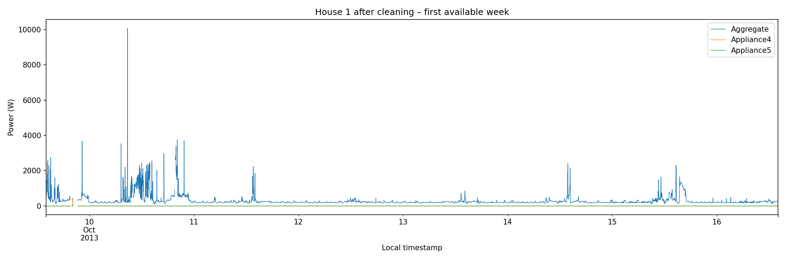
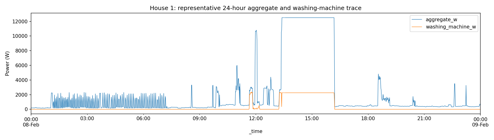
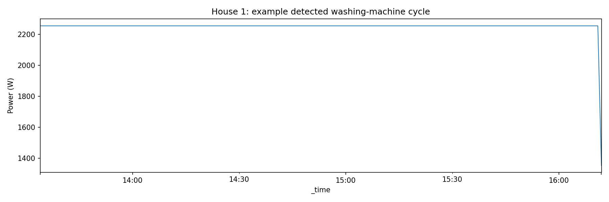
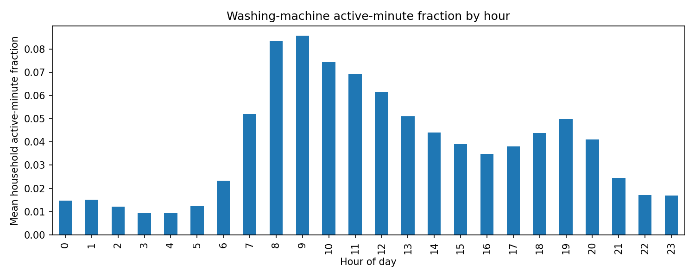
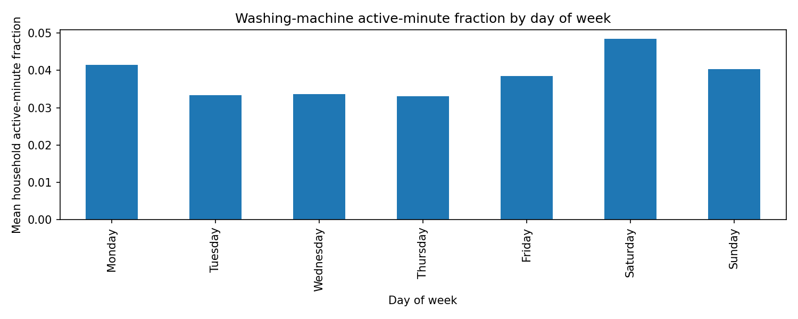
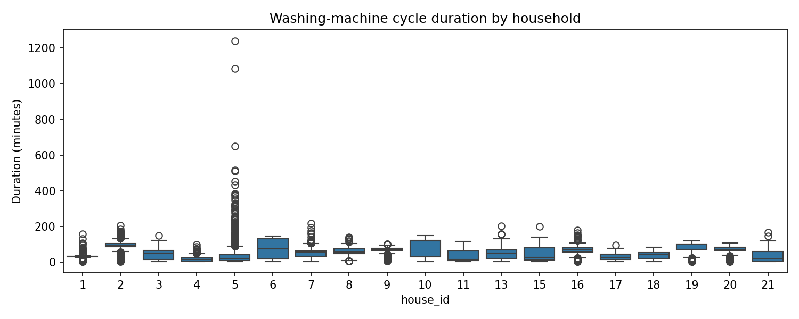
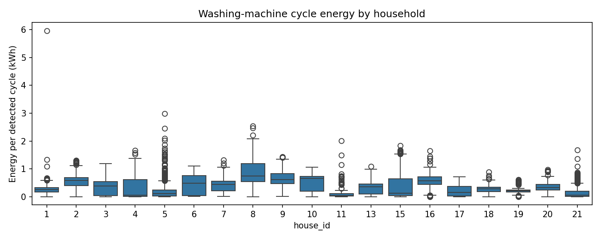

# RESULTS – Washing-machine EDA and NILM

> Figure links are relative to the repository root. Keep the `outputs/figures/` folder in the repository so the images render on GitHub.

## 1. Raw House 1 quality

The raw House 1 cleaning pipeline processed **8,518,763 source rows** from `RAW_House1_Part1.csv` and `RAW_House1_Part2.csv`.

The resulting dataset contains **920,031 one-minute rows**, covering:

- Start: 2013-10-09 14:06:00
- End: 2015-07-10 11:56:00

### Timestamp and duplicate handling

- Invalid timestamps reported: **0**
- Backward timestamp steps in Part 1: **2**
- Backward timestamp steps in Part 2: **0**
- Duplicate rows collapsed in Part 1: **645,418**
- Duplicate rows collapsed in Part 2: **0**

The cleaner does not simply retain the last duplicate record. It groups duplicate timestamps and handles conflicts at the individual channel level. Conflicting timestamp/channel groups are excluded for the affected channel rather than silently selecting an arbitrary reading.

For Part 1, the reported conflicting groups were:

| Channel | Conflicting groups |
|---|---:|
| Aggregate | 33,206 |
| Appliance1 | 3,365 |
| Appliance2 | 5,249 |
| Appliance3 | 6,106 |
| Appliance4 | 67 |
| Appliance5 | 531 |
| Appliance6 | 213 |
| Appliance7 | 1,747 |
| Appliance8 | 3,402 |
| Appliance9 | 959 |

Part 2 reported zero conflicting groups across these channels.

### Missing readings and gap filling

The pipeline resampled readings to one-minute intervals. It interpolated internal gaps of up to two consecutive minutes and retained longer missing intervals as NaN.

| Channel | Missing before filling | Missing after filling |
|---|---:|---:|
| Aggregate | 122,231 | 120,733 |
| Appliance1 | 124,646 | 121,954 |
| Appliance2 | 125,469 | 122,637 |
| Appliance3 | 123,663 | 122,110 |
| Appliance4 | 122,411 | 120,886 |
| Appliance5 | 130,553 | 126,629 |
| Appliance6 | 122,274 | 120,777 |
| Appliance7 | 122,205 | 120,713 |
| Appliance8 | 123,832 | 121,617 |
| Appliance9 | 212,987 | 210,550 |

For the Aggregate channel, **1,498 missing minutes were filled**, while 120,733 remained missing.

### Negative and extreme readings

- Negative readings flagged: **0 across all channels**.
- Readings above 10,000 W flagged but retained:
  - Aggregate: 1,688
  - Appliance1: 13
  - Appliance2: 4
  - Appliance3: 3
  - Appliance4: 32
  - Appliance5: 4
  - Appliance6: 0
  - Appliance7: 8
  - Appliance8: 9
  - Appliance9: 1

These extreme values were flagged rather than automatically removed, preserving the original evidence for further investigation.

The quality report does not contain median sampling intervals or a count of irregular intervals. These statistics should not be inferred from the one-minute output.

### Source overlap and daylight-saving limitation

During the overlap, Part 1 was retained and Part 2 was used only after the maximum valid Part 1 timestamp. This is a deterministic coverage-based selection policy, not evidence that Part 1 is more accurate.

The timestamps are naive UK local wall-clock times. The repeated hour during the 2013-10-27 daylight-saving transition cannot be uniquely disambiguated, so readings in that hour may share the same one-minute bins.

### Before-and-after plots

*Figure 1. House 1 after one-minute aggregation but before short-gap filling.*

*Figure 2. House 1 after the cleaning and short-gap interpolation procedure.*

The cleaning process regularises the timeline and fills only short internal gaps. Longer outages remain missing, and extreme readings are flagged rather than removed. The resulting signal should therefore be interpreted as a cleaned representation of the available measurements, not a completely reconstructed signal.

---

## 2. Washing-machine data availability

The EDA used the official cleaned REFIT files and the appliance mapping in `config/appliance_mapping.csv`.

There were **19 eligible households**:

**House 1–11, 13, and 15–21.**

House 12 and House 14 were not present in the supplied cleaned dataset.

The combined observed date range was 2013-09-17 to 2015-07-10.

### Combined availability

| Measure | Result |
|---|---:|
| Eligible households | 19 |
| Total household timeline minutes | 14,960,575 |
| Observed washing-machine minutes | 12,924,035 |
| Missing washing-machine minutes | 2,036,540 |
| Weighted washing-machine coverage | 86.39% |
| Zero/off minutes reported | 12,414,745 |
| Detected events | 9,998 |

Coverage is calculated as observed washing-machine minutes divided by total household timeline minutes, summed across the 19 households.

### Per-household availability

| House | Coverage (%) | Observed minutes | Zero/off minutes | Detected events |
|---:|---:|---:|---:|---:|
| 1 | 86.96 | 800,109 | 784,662 | 490 |
| 2 | 75.30 | 669,445 | 636,109 | 367 |
| 3 | 84.62 | 748,997 | 707,640 | 945 |
| 4 | 85.95 | 784,659 | 773,514 | 600 |
| 5 | 86.75 | 809,933 | 750,031 | 1,460 |
| 6 | 84.65 | 703,854 | 690,618 | 176 |
| 7 | 86.32 | 762,199 | 699,382 | 1,124 |
| 8 | 89.68 | 716,803 | 692,798 | 414 |
| 9 | 84.57 | 691,823 | 673,175 | 269 |
| 10 | 88.71 | 749,831 | 683,010 | 765 |
| 11 | 88.62 | 500,442 | 493,979 | 167 |
| 13 | 75.52 | 542,164 | 513,286 | 615 |
| 15 | 86.30 | 705,050 | 683,383 | 520 |
| 16 | 82.58 | 646,454 | 621,951 | 359 |
| 17 | 93.25 | 631,057 | 615,770 | 498 |
| 18 | 91.64 | 584,627 | 577,275 | 174 |
| 19 | 93.22 | 631,523 | 606,914 | 299 |
| 20 | 93.94 | 622,712 | 606,950 | 238 |
| 21 | 88.23 | 622,353 | 604,298 | 518 |

### Important interpretation

The reported zero/off minutes should not be treated as confirmed appliance inactivity in every case. Official cleaned data may contain zero-filled periods where original readings were missing. This can inflate apparent off-time and affect the estimated active-minute fraction.

The EDA masks native aggregate and washing-machine readings marked `Issues=1` before one-minute resampling. In model preprocessing, any one-minute bin containing at least one native `Issues=1` sample has both aggregate input and washing-machine target set to missing. The availability summary does not separately report the number of issue-flagged native samples or minute bins, so no count is reported here.

---

## 3. Cycle definition and usage patterns

The analysis uses the following default event definition:

- Active minute: washing-machine power at least 10 W.
- Bridge inactive gaps of up to 2 minutes.
- Retain events lasting at least 5 minutes.

This is a transparent heuristic for identifying periods of washing-machine activity. It is not a manufacturer-specific definition of a complete wash programme. A detected event may represent part of a programme or multiple closely spaced activities.

### Overall detected-event statistics

The analysis detected **9,998 events across 19 households**.

| Statistic | Duration | Peak power | Energy |
|---|---:|---:|---:|
| Mean | 51.04 min | 1,474.41 W | 0.351 kWh |
| Median | 45 min | 2,027.84 W | 0.297 kWh |
| Minimum | 5 min | 10 W | 0.00076 kWh |
| Maximum | 1,240 min | 5,031 W | 5.963 kWh |

Energy is estimated by summing one-minute average power readings and converting W-minutes to kWh.

The maximum detected duration of 1,240 minutes is unusually long for a single washing-machine event. It may reflect a bridged period of activity, unusual appliance behaviour, data-quality issues, or the limitations of the event heuristic. It should not automatically be interpreted as a single wash programme.

### Per-household event statistics

| House | Events | Median duration (min) | Mean duration (min) | Median peak (W) | Median energy (kWh) |
|---:|---:|---:|---:|---:|---:|
| 1 | 490 | 33 | 32.46 | 2,292.74 | 0.260 |
| 2 | 367 | 97 | 92.66 | 2,084.40 | 0.584 |
| 3 | 945 | 51 | 43.28 | 1,873.78 | 0.379 |
| 4 | 600 | 15 | 19.90 | 600.31 | 0.057 |
| 5 | 1,460 | 22.5 | 40.31 | 467.13 | 0.109 |
| 6 | 176 | 76 | 74.52 | 2,031.94 | 0.488 |
| 7 | 1,124 | 57 | 55.36 | 2,067.00 | 0.439 |
| 8 | 414 | 56.5 | 58.22 | 2,325.75 | 0.736 |
| 9 | 269 | 72 | 69.44 | 2,200.40 | 0.608 |
| 10 | 765 | 119 | 87.62 | 2,027.60 | 0.654 |
| 11 | 167 | 15 | 36.90 | 361.14 | 0.039 |
| 13 | 615 | 51 | 46.75 | 2,103.90 | 0.348 |
| 15 | 520 | 27 | 42.79 | 702.16 | 0.120 |
| 16 | 359 | 71 | 68.02 | 2,045.20 | 0.574 |
| 17 | 498 | 29 | 32.08 | 1,969.63 | 0.148 |
| 18 | 174 | 46.5 | 42.64 | 2,181.52 | 0.279 |
| 19 | 299 | 102 | 82.55 | 1,369.40 | 0.208 |
| 20 | 238 | 73 | 67.61 | 2,261.78 | 0.326 |
| 21 | 518 | 20 | 34.35 | 347.92 | 0.050 |

The event statistics vary considerably across homes. For example, House 5 has the largest number of detected events, while House 6 has the fewest. Median event duration ranges from 15 minutes in Houses 4 and 11 to 119 minutes in House 10.

Differences may reflect appliance characteristics, household behaviour, data coverage, appliance-channel mapping, or the event-detection heuristic. They should not be interpreted as direct evidence that one household is more or less energy efficient.

### Generated plots

The following figures are generated in `outputs/figures/` and are linked below. The representative trace and event example use House 1 as an illustration; the per-household comparisons cover the mapped households.

The per-household representative-day and example-event figures are also available for each mapped home: Houses 1–11, 13, and 15–21. The files follow the naming pattern `house_N_representative_24h.png` and `house_N_example_cycle.png` in `outputs/figures/`.

These plots help examine when washing machines are used, how their power signatures evolve during detected events, and how event characteristics vary between households.

### Sensitivity analysis

The reported event results use the default 10 W threshold, 2-minute gap bridging and 5-minute minimum duration.

Alternative thresholds (5 W, 10 W and 20 W) and minimum durations (3, 5 and 10 minutes) have not been quantified in the supplied output files. These sensitivity checks remain useful follow-up work because the detected event count and duration distribution can change materially with these settings.

---

## 4. NILM model

The model estimates washing-machine power from aggregate household power using aggregate-only historical features.

Features include:

- Lagged aggregate power values.
- Rolling mean and standard deviation.
- Cyclical time features.

The model compares `HistGradientBoostingRegressor` and `RandomForestRegressor`, selecting the model with the lower validation MAE.

### Held-out test results

The selected model was **HistGradientBoostingRegressor**.

| Metric | Result |
|---|---:|
| Selected model | HistGradientBoostingRegressor |
| Held-out households | 19 |
| Test rows | 1,568,446 |
| MAE | 9.30 W |
| RMSE | 85.52 W |
| R² | 0.203 |
| Actual test energy | 157.41 kWh |
| Predicted test energy | 143.45 kWh |
| Absolute energy error | 8.87% |
| Active-state precision | 13.67% |
| Active-state recall | 43.33% |
| Active-state F1 | 0.208 |

The predicted test energy is lower than the actual test energy. The model therefore underestimates total washing-machine energy by approximately 8.87%.

The MAE is relatively modest, but the RMSE is much higher. This indicates that while many minute-level predictions have small errors, some observations have substantially larger errors.

The positive R² of approximately 0.203 indicates modest explanatory power. The model captures some variation in washing-machine power but does not explain most of the variation.

Active-state detection is weak:

- Precision of 13.67% means that many predicted active minutes are false positives.
- Recall of 43.33% means that the model misses more than half of the actual active minutes.
- The F1 score of 0.208 reflects this limited active-state detection performance.

The overall energy error is more encouraging than the minute-level classification metrics. However, aggregate energy agreement does not prove that the model reconstructs individual washing cycles accurately. Cycle-level reconstruction would require separate event matching and energy evaluation.

### Household-level variation

Performance varies substantially between households. For example:

- House 10 achieved an active-state F1 of approximately 0.492.
- House 7 achieved an active-state F1 of approximately 0.487.
- House 19 achieved an active-state F1 of approximately 0.016.

House 11 has almost zero actual test energy (approximately 0.005 kWh). Its extremely large percentage energy error and very negative R² are unstable metrics caused by the near-zero actual energy denominator and very low target variance. It should not be interpreted as a normal model-performance comparison.

The overall 8.87% energy error therefore hides substantial differences between individual households.

### Actual-versus-predicted plots

The generated household-level test plots are linked below. Review these alongside the household metrics table; performance is not uniform across homes.

- [House 1: actual versus predicted](outputs/figures/house_1_actual_vs_predicted.png)
- [House 2: actual versus predicted](outputs/figures/house_2_actual_vs_predicted.png)
- [House 3: actual versus predicted](outputs/figures/house_3_actual_vs_predicted.png)
- [House 4: actual versus predicted](outputs/figures/house_4_actual_vs_predicted.png)
- [House 5: actual versus predicted](outputs/figures/house_5_actual_vs_predicted.png)
- [House 6: actual versus predicted](outputs/figures/house_6_actual_vs_predicted.png)
- [House 7: actual versus predicted](outputs/figures/house_7_actual_vs_predicted.png)
- [House 8: actual versus predicted](outputs/figures/house_8_actual_vs_predicted.png)
- [House 9: actual versus predicted](outputs/figures/house_9_actual_vs_predicted.png)
- [House 10: actual versus predicted](outputs/figures/house_10_actual_vs_predicted.png)
- [House 11: actual versus predicted](outputs/figures/house_11_actual_vs_predicted.png)
- [House 13: actual versus predicted](outputs/figures/house_13_actual_vs_predicted.png)
- [House 15: actual versus predicted](outputs/figures/house_15_actual_vs_predicted.png)
- [House 16: actual versus predicted](outputs/figures/house_16_actual_vs_predicted.png)
- [House 17: actual versus predicted](outputs/figures/house_17_actual_vs_predicted.png)
- [House 18: actual versus predicted](outputs/figures/house_18_actual_vs_predicted.png)
- [House 19: actual versus predicted](outputs/figures/house_19_actual_vs_predicted.png)
- [House 20: actual versus predicted](outputs/figures/house_20_actual_vs_predicted.png)
- [House 21: actual versus predicted](outputs/figures/house_21_actual_vs_predicted.png)

Across the examples, the model captures some broad changes in appliance power but does not consistently reconstruct individual activity periods. The household-level metrics and plots should be considered together: a reasonable total-energy estimate can coexist with missed activity, false positives and underestimated peaks.

The model should be described as a baseline regression approach, not a reliable washing-cycle reconstruction system.

---

## 5. Validation and leakage

Each household is sorted chronologically and divided into:

- 70% training data.
- 15% validation data.
- 15% test data.

Model selection uses validation MAE. The final test period is held out for reporting.

Features are derived from aggregate power history rather than the washing-machine target. Lagged and rolling features are created before incomplete feature rows are dropped, so missing timestamps are not silently skipped when constructing the historical features.

This approach avoids random row-level splitting and ensures that test observations occur later in time than training observations within each household.

However, this is a **temporal within-house evaluation**, not a strict unseen-house transfer experiment. The model is trained using historical observations from the same households on which it is evaluated.

A leave-one-house-out experiment would provide a stronger test of generalisation to a completely unseen household.

---

## 6. Failure analysis and limitations

### Missing, issue-flagged and zero-filled readings

Missing readings can reduce the amount of usable training data and distort activity estimates. The EDA masks native readings marked `Issues=1` before one-minute resampling; the model masks an entire one-minute bin if any native sample in that bin is issue-flagged. The availability summary does not separately quantify these issue-flagged samples or bins. Official cleaned files may also contain zero-filled periods, which can make missing readings appear to be genuine appliance inactivity.

### Appliance replacement and channel changes

Appliance channels may not represent the same appliance consistently throughout the full dataset. House 13's appliance mapping includes a documented appliance change on 25 March 2015. This may affect the consistency of its washing-machine labels.

### Overlapping appliance signatures

Other appliances can produce power signatures that overlap with washing-machine activity. Aggregate-only input makes it difficult to distinguish appliances with similar power characteristics.

### Unmetered loads and aggregate-meter noise

The aggregate meter may include loads that do not have corresponding appliance-level submeter readings. Metering noise and inconsistencies can also affect the relationship between aggregate and appliance power.

### Class imbalance

Washing machines are inactive for most minutes. This means a model can achieve a relatively low overall regression error while still performing poorly at identifying actual washing-machine activity.

### One-minute resolution

One-minute averages smooth short power peaks and remove some of the detailed switching behaviour that may help distinguish appliances. This limits accurate reconstruction of short events and peak power.

### UK-to-India transfer

REFIT represents UK households and their appliances, usage patterns, electrical characteristics and living conditions. Direct transfer to Indian households may not work reliably because of differences in appliances, voltage, household size, climate, usage patterns and operating behaviour.

A model intended for Indian deployment would require local data collection, validation and potentially retraining.

---

## 7. 15-minute and 30-minute resolution

The supplied results evaluate the data at one-minute resolution. Separate 15-minute and 30-minute experiments have not yet been run, so no numerical performance degradation is claimed.

Coarser intervals are expected to:

- Smooth short power peaks.
- Blur washing-machine event start and end times.
- Merge multiple appliance events.
- Cause short events to disappear.
- Reduce the accuracy of peak-power estimation.
- Make minute-level appliance attribution more difficult.

Energy totals may remain approximately estimable if the resampled values represent true mean power and data coverage is complete. However, cycle detection and appliance-level power reconstruction are likely to deteriorate.

A fair comparison should aggregate both the aggregate input and appliance target to 15-minute and 30-minute intervals, retrain and evaluate using equivalent chronological splits, and compare energy error, MAE, RMSE and event-detection performance.

The effect should be quantified experimentally before drawing conclusions about suitability for those resolutions.

---

## 8. Summary

The analysis covers 19 REFIT households and identifies 9,998 heuristic washing-machine activity events. The raw House 1 pipeline creates a one-minute timeline, fills short internal gaps and retains longer outages for transparency.

The NILM baseline achieves an overall test energy error of 8.87%, but its active-state F1 of 0.208 shows that minute-level appliance detection remains weak. Household-level results also vary substantially.

The results demonstrate the potential of aggregate-only appliance estimation while highlighting the challenges of missing data, appliance variability, overlapping signatures, class imbalance and temporal resolution.

Further work should prioritise event-level evaluation, sensitivity analysis, stronger activity detection and an unseen-household validation experiment.
